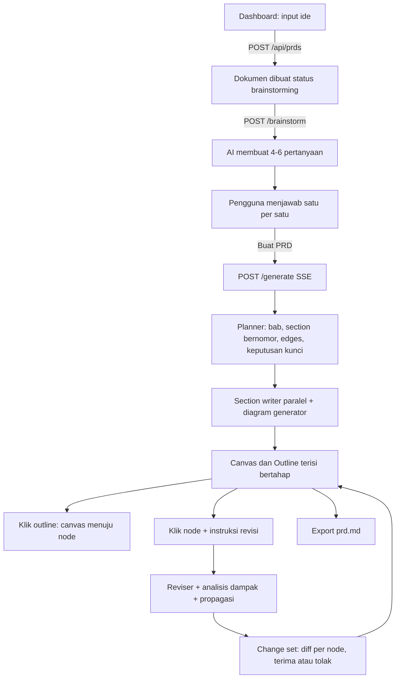
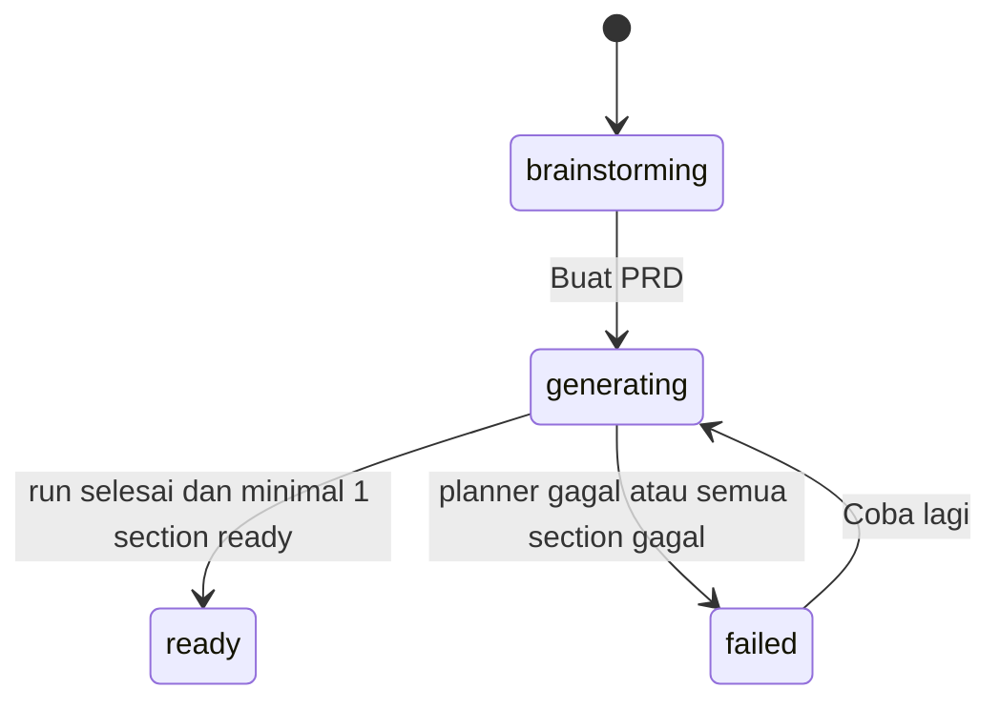

# PRD: bikinprd (ngePRD) v2: Rombak Alur Menjadi Dashboard + Brainstorm + Agent Runtime + Canvas

| | |
|---|---|
| Versi | 2.1 (rombak total alur v1, ditambah Outline dan Revisi Berantai) |
| Tanggal | 2 November 2026 |
| Status | Draft siap dieksekusi |
| Menggantikan | Alur v1 (TASK-001 s.d. TASK-008) |
| Rencana task | TASK-009 s.d. TASK-017 (lihat bagian 10) |

> **Catatan versi 2.1.** Perubahan dari 2.0: (1) PRD utuh disusun Planner dalam bab dan section bernomor (`1`, `1.1`, `1.2`, ...) yang ditentukan AI sesuai kebutuhan ide; (2) panel **Outline** di samping canvas yang terhubung dua arah dengan node; (3) revisi lewat instruksi per node yang **merambat ke bagian terdampak** (*change set*), menggantikan konsep "Saran AI" satu node; (4) edit teks manual diturunkan menjadi jalur sekunder.

Dokumen ini adalah sumber kebenaran untuk rombakan. Setiap requirement punya ID (mis. `FR-DASH-03`) dan prioritas: **M** = Must (wajib untuk MVP), **S** = Should (dikerjakan jika waktu cukup), **C** = Could (ditunda).

---

## 1. Ringkasan

bikinprd adalah aplikasi web yang mengubah satu kalimat ide proyek menjadi dokumen PRD terstruktur yang bisa diedit di canvas infinite dan diekspor sebagai `prd.md` untuk diberikan ke coding agent.

Alur baru:

1. Pengguna membuka **dashboard bergaya chatbot**: sidebar berisi daftar PRD sebelumnya, input ide di tengah.
2. Setelah mengirim ide, AI **dipaksa mengajukan 4 sampai 6 pertanyaan brainstorm** terstruktur. Pengguna menjawabnya (pilih opsi, ketik sendiri, atau serahkan ke AI).
3. **Agent runtime** di server memproses PRD secara bertahap. Planner menentukan sendiri bab dan section spesifikasi yang dibutuhkan ide itu (mis. `1.1 Project Specification`, `3.2 Tech Stack`), lalu section writer paralel dan diagram generator menyusunnya, dan hasilnya disiarkan lewat SSE.
4. **Setelah brainstorming, PRD sudah utuh.** Hasilnya dikonversi menjadi **node dan edge** di canvas infinite. Di samping canvas ada panel **Outline bernomor**: klik satu item dan canvas langsung menuju node-nya.
5. Canvas adalah tempat **merevisi lewat instruksi**. Pengguna klik node, mengetik misalnya "aku mau pakai Python" di node Tech Stack, dan AI merevisi node itu **beserta bagian lain yang terdampak** (arsitektur, data model, roadmap, label diagram) sehingga PRD tetap konsisten. Perubahan tampil sebagai satu *change set* (diff per node) yang diterima atau ditolak, dan bisa diurungkan. Edit teks manual tetap ada sebagai jalur sekunder.
6. Seluruh data disimpan di **MongoDB Atlas**. Dokumen JSON adalah satu-satunya sumber kebenaran. Canvas, preview, dan export Markdown hanyalah *view* dari JSON itu.

---

## 2. Latar Belakang: Masalah di v1

| # | Masalah v1 | Dampak |
|---|---|---|
| 1 | Pertanyaan arsitektur ditaruh sebagai node di canvas | Canvas bercampur antara proses tanya-jawab dan hasil. Alurnya terasa aneh. |
| 2 | Satu panggilan AI panjang (15 s.d. 25 detik) dengan timeout awal 6 detik | Selalu timeout, lalu jatuh ke template. Diperbaiki sementara dengan timeout 45 detik, tetapi akar masalahnya (panggilan terlalu besar) masih ada. |
| 3 | `fallbackPrd.ts` diam-diam menggantikan hasil AI | Bug timeout tidak ketahuan berhari-hari. Pengguna mengira template adalah hasil AI. |
| 4 | State hanya di LocalStorage (Zustand persist), satu canvas | Tidak ada daftar PRD, data hilang jika browser dibersihkan. |
| 5 | Output AI berupa teks bebas | Tidak bisa diparse menjadi node, diagram, atau diedit per bagian. |

---

## 3. Tujuan dan Non-Tujuan

### Tujuan
- **G1.** Pengguna bisa dari ide sampai PRD siap ekspor dalam satu sesi, dengan hasil pertama (node pertama) muncul di canvas dalam waktu singkat.
- **G2.** Setiap PRD tersimpan permanen di MongoDB dan bisa dibuka lagi dari sidebar.
- **G3.** Setelah PRD utuh jadi, pengguna merevisinya cukup dengan instruksi singkat di node (mis. "pakai Python"). AI merevisi node itu **dan bagian lain yang terdampak** sehingga PRD tetap konsisten, tanpa mengulang seluruh generate.
- **G4.** Output AI selalu divalidasi (Zod) sebelum masuk database. Kegagalan selalu terlihat dan bisa dicoba ulang. Tidak ada fallback diam-diam.
- **G5.** Diagram (flow, ERD, sequence) dihasilkan AI dalam bentuk Mermaid dan dirender di web.
- **G6.** Markdown hasil ekspor cukup rapi dan terstruktur untuk langsung dipakai sebagai input coding agent.
- **G7.** PRD bisa dinavigasi lewat outline bernomor (`1`, `1.1`, `1.2`, ...) di samping canvas. Klik item membawa pengguna ke node-nya.

### Non-tujuan (untuk versi ini)
- Login/akun (memakai identitas anonymous berbasis cookie, lihat 7.4).
- Kolaborasi multi-user realtime.
- Streaming token-per-token dari model. Streaming dilakukan per section.
- Export PDF/Notion/Google Docs (PDF hanya `C`).
- Edit canvas di layar mobile (dashboard dan brainstorm tetap responsif).
- Versioning dokumen penuh (hanya riwayat change set revisi AI beserta Urungkan).
- Deploy produksi. Konfigurasi harus berbasis env supaya siap, tetapi 9router lokal tidak bisa dijangkau dari hosting (lihat risiko R5).
- Migrasi data v1 dari LocalStorage. Data lama diabaikan.

---

## 4. Pengguna dan User Stories

**Persona utama:** solo builder, mahasiswa, atau founder non-teknis yang punya ide proyek dan butuh PRD yang bisa diberikan ke coding agent (Cursor, Antigravity, Claude Code, dsb.).

| ID | Sebagai pengguna, saya ingin... | Supaya... |
|---|---|---|
| US-1 | membuka dashboard dan melihat daftar PRD yang pernah saya buat | bisa melanjutkan pekerjaan sebelumnya |
| US-2 | mengetik ide lalu menekan Enter untuk memulai | prosesnya terasa seperti chat, tanpa form panjang |
| US-3 | dijawabkan pertanyaan yang spesifik pada ide saya, dengan opsi siap pilih | tidak perlu memikirkan semuanya dari nol |
| US-4 | melihat PRD muncul bertahap di canvas saat dibuat | tidak menunggu lama di layar kosong |
| US-5 | melihat daftar isi bernomor di samping canvas dan mengkliknya untuk langsung menuju node yang dimaksud | cepat menemukan bagian PRD tanpa mencari di canvas |
| US-6 | klik sebuah node lalu mengetik instruksi (mis. "aku mau pakai Python" di node Tech Stack) | AI yang mengubahnya, dan bagian lain yang berkaitan ikut disesuaikan supaya PRD tidak saling bertentangan |
| US-7 | mencoba ulang bagian yang gagal tanpa mengulang semuanya | tidak membuang waktu |
| US-8 | menyalin atau mengunduh `prd.md` | bisa langsung diberikan ke coding agent |
| US-9 | menutup browser lalu kembali lagi dan semuanya masih ada | data aman |
| US-10 | melihat perubahan yang diusulkan AI (per node) sebelum diterima, dan bisa menerima sebagian | mengontrol hasil akhir |
| US-11 | mengurungkan perubahan AI yang sudah terlanjur diterima | tidak takut mencoba instruksi |
| US-12 | sesekali mengedit teks atau kode diagram secara manual | menangani perbaikan kecil tanpa memanggil AI |

---

## 5. Alur End-to-End



Status dokumen:



Catatan: kegagalan sebagian section **tidak** mengubah status dokumen menjadi `failed`. Dokumen tetap `ready`, dan section yang gagal ditandai sendiri dengan tombol Coba lagi.

---

## 6. Requirements Fungsional

### 6.1 Dashboard (`FR-DASH`)

| ID | Requirement | P |
|---|---|---|
| FR-DASH-01 | Halaman `/` memakai layout chatbot: sidebar kiri, area tengah berisi sapaan dan input ide besar. | M |
| FR-DASH-02 | Sidebar menampilkan daftar PRD milik owner dari `GET /api/prds`, urut `updatedAt` menurun, dikelompokkan *Hari ini / 7 hari terakhir / Lebih lama*. Tiap item: judul dan chip status. | M |
| FR-DASH-03 | Enter mengirim, Shift+Enter baris baru. Validasi 10 s.d. 2000 karakter. Tombol kirim nonaktif saat kosong atau sedang mengirim. | M |
| FR-DASH-04 | Submit memanggil `POST /api/prds`, lalu redirect ke `/prd/[id]` dengan loading state. | M |
| FR-DASH-05 | Klik item sidebar membuka `/prd/[id]`. Item aktif disorot. Sidebar tetap tampil di halaman workspace. | M |
| FR-DASH-06 | Ganti nama (inline) dan hapus PRD dengan dialog konfirmasi. | S |
| FR-DASH-07 | Pencarian judul di sidebar (client-side). | S |
| FR-DASH-08 | Empty state dan 3 contoh ide yang bisa diklik untuk mengisi input. | S |
| FR-DASH-09 | Responsif: sidebar menjadi drawer di lebar < 768 px. | S |
| FR-DASH-10 | Duplikat PRD. | C |

### 6.2 Fase Brainstorm (`FR-BRN`)

| ID | Requirement | P |
|---|---|---|
| FR-BRN-01 | Workspace dengan status `brainstorming` memanggil `POST /api/prds/[id]/brainstorm` (idempoten: jika pertanyaan sudah ada, dikembalikan apa adanya) dan menampilkan loading "AI menyiapkan pertanyaan". | M |
| FR-BRN-02 | AI wajib menghasilkan 4 s.d. 6 pertanyaan, tiap pertanyaan 3 s.d. 4 opsi pendek ditambah opsi jawaban sendiri. Output divalidasi Zod dengan retry. Jika tetap gagal: tampilkan error dan tombol Coba lagi. **Tidak ada pertanyaan default/template.** | M |
| FR-BRN-03 | Wizard menampilkan satu pertanyaan per layar dengan progres "n dari N", tombol Kembali/Lanjut. Opsi single-select. Opsi "Lainnya" membuka input teks. | M |
| FR-BRN-04 | Setiap jawaban langsung disimpan ke Mongo (`PUT .../brainstorm/answers`). Refresh halaman melanjutkan dari langkah terakhir. | M |
| FR-BRN-05 | Tiap pertanyaan punya opsi "Serahkan ke AI" (jawaban ditandai `delegated`). | M |
| FR-BRN-06 | Layar ringkasan sebelum generate: semua jawaban bisa diubah, lalu tombol **Buat PRD**. | M |
| FR-BRN-07 | Pertanyaan harus spesifik pada ide (aturan kualitas di 7.8), bukan pertanyaan generik yang cocok untuk semua proyek. | M |
| FR-BRN-08 | Ronde pertanyaan lanjutan (2 s.d. 3 pertanyaan) berdasarkan jawaban. | C |

### 6.3 Agent Runtime (`FR-RUN`)

| ID | Requirement | P |
|---|---|---|
| FR-RUN-01 | **Buat PRD** mengubah status menjadi `generating` dan memanggil `POST /api/prds/[id]/generate` yang merespons stream SSE. | M |
| FR-RUN-02 | Pipeline: Planner, lalu Section Writer paralel (batas `AGENT_CONCURRENCY`, default 3), lalu Diagram Generator untuk section yang butuh diagram. | M |
| FR-RUN-03 | Hasil tiap section ditulis ke Mongo begitu selesai, baru event SSE dikirim. Refresh di tengah generate tidak menghilangkan progres. | M |
| FR-RUN-04 | Kegagalan satu section tidak menghentikan section lain. Section gagal ditandai `failed` beserta pesan error. | M |
| FR-RUN-05 | Idempoten dan bisa dilanjutkan: memanggil `/generate` lagi hanya memproses section `pending`, `failed`, atau `writing` yang basi. Body opsional `{ sectionIds }` untuk mencoba ulang section tertentu. | M |
| FR-RUN-06 | Satu run aktif per dokumen (lock di dokumen). Run kedua mendapat `409 RUN_IN_PROGRESS`. Lock tanpa heartbeat lebih dari 3 menit dianggap basi dan boleh diambil alih. | M |
| FR-RUN-07 | **Dilarang** ada fallback template. Semua kegagalan AI terlihat di UI dan tercatat di log server. | M |
| FR-RUN-08 | Tombol **Batalkan**: klien membatalkan request (AbortController). Server berhenti menjadwalkan section baru dan melepas lock. Section yang belum selesai kembali `pending`. | M |
| FR-RUN-09 | Progress bar "n/N section selesai". | S |
| FR-RUN-10 | Heartbeat SSE tiap 15 detik agar koneksi tidak diputus proxy. | S |
| FR-RUN-11 | Planner menentukan sendiri bab dan section yang dibutuhkan ide itu (3 s.d. 5 bab, total 8 s.d. 14 section), bukan daftar tetap. PRD sudah utuh begitu run selesai, tanpa langkah penyusunan tambahan oleh pengguna. | M |

### 6.4 Canvas (`FR-CNV`)

| ID | Requirement | P |
|---|---|---|
| FR-CNV-01 | Canvas infinite (pan/zoom) memakai `@xyflow/react`. | M |
| FR-CNV-02 | Setelah event `plan.ready`, canvas langsung menampilkan `IdeaNode` dan `SectionNode` berstatus skeleton beserta edge-nya. Konten mengisi bertahap seiring event `section.completed`. | M |
| FR-CNV-03 | Konversi dokumen menjadi nodes/edges lewat fungsi murni `docToFlow` (7.9). | M |
| FR-CNV-04 | Tata letak otomatis dagre arah kiri ke kanan untuk node tanpa `position`. Node tidak boleh bertumpuk. Posisi hasil drag disimpan (`PATCH /layout`, debounce, saat drag selesai). | M |
| FR-CNV-05 | `SectionNode` menampilkan: nomor (mis. `1.1`), badge tipe, judul, status (pending/writing/ready/failed), konten markdown, diagram, dan aksi (**Ubah dengan AI**, Edit, Coba lagi). | M |
| FR-CNV-06 | Edge beranimasi saat node tujuan `writing`, solid saat `ready`. | S |
| FR-CNV-07 | Tombol **Rapikan layout** (hapus posisi manual lalu layout ulang). | S |
| FR-CNV-08 | MiniMap, Controls, dan fit-view. | S |
| FR-CNV-09 | Tambah section manual (tipe `custom`, ke bab tertentu), hapus section (dengan konfirmasi), sambung/putus edge manual. Nomor di outline dan node dihitung ulang otomatis. | S |
| FR-CNV-10 | Penanda bab pada node (aksen warna tipis atau label bab) agar node satu bab mudah dikenali. | S |
| FR-CNV-11 | Sidebar daftar PRD (kiri) bisa dilipat di workspace untuk memperluas area canvas. | S |

### 6.4a Outline dan Navigasi (`FR-OUT`)

Panel daftar isi di samping canvas. Berfungsi sebagai peta PRD dan jalan pintas ke node.

| ID | Requirement | P |
|---|---|---|
| FR-OUT-01 | Panel **Outline** di sisi kanan canvas (bisa dilipat) menampilkan hierarki bab dan section bernomor (`1`, `1.1`, `1.2`, `2`, `2.1`, ...). Nomor **dihitung** dari urutan bab dan section, tidak disimpan, sehingga tetap benar setelah tambah/hapus section. | M |
| FR-OUT-02 | Outline terisi penuh begitu `plan.ready` tiba, sebelum konten selesai ditulis. Tiap item punya ikon status: pending, writing, ready, failed, dan penanda "ada revisi menunggu keputusan". | M |
| FR-OUT-03 | Klik item section: canvas menengahkan dan memperbesar node itu dengan animasi (sekitar 400 ms, `setCenter`). Node terpilih dan disorot sesaat. | M |
| FR-OUT-04 | Sinkron dua arah: memilih node di canvas menyorot item di outline dan menggulung outline ke sana. | M |
| FR-OUT-05 | Bab (level 1) bisa dilipat. Klik judul bab melakukan fit-view ke semua node pada bab itu. | M |
| FR-OUT-06 | Item yang terdampak change set yang menunggu keputusan diberi badge. Klik langsung membuka item itu di tab Revisi. | S |
| FR-OUT-07 | Navigasi keyboard di outline (panah atas/bawah, Enter). | S |
| FR-OUT-08 | Di lebar < 1024 px outline menjadi drawer. | S |
| FR-OUT-09 | Drag-and-drop untuk mengurutkan section/bab di outline. | C |

### 6.5 Edit Manual (`FR-EDT`)

Jalur **sekunder**. Revisi utama dilakukan lewat instruksi ke AI (6.6). Edit manual dipakai untuk perbaikan kecil.

| ID | Requirement | P |
|---|---|---|
| FR-EDT-01 | Edit inline judul dan konten markdown (textarea) di node. Autosave debounce sekitar 800 ms, hanya mengirim section yang berubah. Elemen edit memakai kelas `nodrag nowheel` agar tidak bentrok dengan gestur canvas. | S |
| FR-EDT-02 | Indikator status simpan per node: *Menyimpan… / Tersimpan / Gagal, coba lagi*. | S |
| FR-EDT-03 | Concurrency optimistis memakai `rev` per section, berlaku untuk edit manual **dan** penerapan change set. Konflik menghasilkan `409` dan banner dengan pilihan **Muat ulang** atau **Timpa** (khusus edit manual). | M |
| FR-EDT-04 | Section berstatus `pending` atau `writing` tidak bisa diedit maupun dijadikan target revisi. | M |
| FR-EDT-05 | Diagram Mermaid dirender di dalam node. | M |
| FR-EDT-06 | Jika render Mermaid gagal, jalankan **auto-repair** (maksimal 2 kali, lihat 7.10). Setelah itu tampilkan kode mentah, tandai `invalid`, beri tombol Coba perbaiki lagi. | M |
| FR-EDT-07 | Modal perbesar diagram. | S |
| FR-EDT-08 | Undo/redo lokal (Ctrl+Z) selama sesi edit manual. | C |
| FR-EDT-09 | Edit kode diagram dengan preview langsung dan pesan error sintaks inline. | S |

### 6.6 Revisi dengan Instruksi AI (`FR-AI`)

Jalur utama pengguna mengubah PRD. Pengguna tidak mengetik ulang isi node. Ia memberi instruksi singkat, dan AI yang mengubahnya **dengan memperhitungkan seluruh dokumen** supaya PRD tidak menjadi tambal-sulam. Satu instruksi menghasilkan satu **change set**: perubahan pada node yang dipilih (*origin*) ditambah perubahan pada node lain yang terdampak.

**Skenario acuan (juga menjadi acceptance test):**

1. PRD hasil generate memuat `3.2 Tech Stack` = Node.js + Express + Mongoose. `3.1 Arsitektur` dan diagramnya menyebut "Express API". `3.3 Data Model` menyebut Mongoose. `4.1 Roadmap` menyebut setup `npm`.
2. Pengguna klik node `3.2`, mengetik "aku mau pakai Python", Enter.
3. Panel kanan pindah ke tab **Revisi**: "Menganalisis dampak…", lalu "Menyusun perubahan 1/3…".
4. Change set berisi: **3.2** (origin) menjadi Python + FastAPI, dengan asumsi framework disebut di alasan; keputusan kunci berubah dari "Backend: Node.js + Express" ke "Backend: Python + FastAPI"; **3.1** (label diagram "Express API" menjadi "FastAPI"), **3.3** (Mongoose menjadi ODM/driver Python), dan **4.1** (npm menjadi pip/venv) ikut berubah. Bab 1 dan 2 tidak tersentuh.
5. Pengguna melihat diff per node, menekan **Terima semua**. Node terbarui, badge di outline hilang, `keyDecisions` ikut berubah, tombol **Urungkan** tersedia.
6. Lulus jika tidak ada sisa istilah lama (Express, Node.js, npm, Mongoose) di section lain, kecuali disebut sebagai konteks yang disengaja (mis. "migrasi dari Node.js").

| ID | Requirement | P |
|---|---|---|
| FR-AI-01 | Saat node dipilih, muncul **bar instruksi** mengambang di bawah node ("Ubah bagian ini…", Enter untuk kirim) dengan chip cepat (*Lebih ringkas, Lebih detail, Perbaiki diagram*, plus chip khusus tipe). Tombol **Tulis ulang** pada node `ready` hanyalah pintasan instruksi bawaan lewat alur yang sama. | M |
| FR-AI-02 | Kirim instruksi memanggil `POST /api/prds/[id]/changesets` (SSE). Panel kanan berpindah ke tab **Revisi** dan menampilkan langkah: *Menganalisis dampak* lalu *Menyusun perubahan n/N*. | M |
| FR-AI-03 | Reviser menerima **seluruh dokumen** (keputusan kunci dan semua section bernomor), bukan hanya node terpilih. Perubahan harus seminimal mungkin: bagian yang tidak terkait instruksi dipertahankan persis. | M |
| FR-AI-04 | **Perubahan berantai.** Reviser mengembalikan perubahan keputusan kunci, daftar istilah lama yang tidak berlaku lagi, dan daftar section terdampak lengkap dengan alasan. Server menambah deteksi deterministik (*term-match*) untuk section yang masih memuat istilah lama tetapi terlewat oleh AI. Tiap section terdampak direvisi oleh Propagator. | M |
| FR-AI-05 | Hasil berupa satu change set: item origin dan item terdampak, masing-masing dengan diff, alasan, dan checkbox. Origin tidak bisa di-uncheck. Tombol **Terima semua**, **Terima terpilih**, **Tolak**. **Tidak ada perubahan ke dokumen sebelum pengguna menerima.** Meng-uncheck item hasil term-match memunculkan peringatan potensi inkonsistensi. | M |
| FR-AI-06 | Penerapan bersifat **atomik** (satu operasi update dokumen) dengan cek `baseRev` semua item. Jika ada konflik: `409` beserta daftar section yang bentrok, dan opsi "Buat ulang change set dari versi terbaru". Tidak ada item yang berubah sebagian. | M |
| FR-AI-07 | Saat diterima, `keyDecisions` dokumen ikut diperbarui, sehingga generate dan revisi berikutnya memakai keputusan terbaru. | M |
| FR-AI-08 | **Urungkan** change set yang sudah diterima, selama section terkait belum berubah lagi (`rev` masih sama dengan `appliedRev`). Item yang sudah berubah dilewati dengan peringatan. | M |
| FR-AI-09 | Maksimal satu change set berstatus `generating` atau `pending` per dokumen. Change set baru menunggu keputusan atas yang lama. Change set `generating` tanpa pembaruan lebih dari 3 menit dianggap gagal. | M |
| FR-AI-10 | Reviser mengisi `warnings` jika instruksi berpotensi bertentangan dengan keputusan atau bagian lain. Peringatan tampil di tab Revisi sebelum pengguna menerima. | M |
| FR-AI-11 | Hanya section berstatus `ready` yang bisa menjadi origin. Section `failed` memakai tombol **Coba lagi**, bukan revisi. | M |
| FR-AI-12 | **Redirect.** Jika instruksi jelas ditujukan ke bagian lain (mis. "tambah fitur chat" di node Tech Stack), AI tidak mengubah apa pun dan menawarkan "Terapkan di 2.1 Fitur". | S |
| FR-AI-13 | Riwayat change set per dokumen dan per section beserta statusnya (diterima, ditolak, diurungkan). | S |
| FR-AI-14 | Chip cepat disesuaikan dengan tipe section (mis. Tech Stack: *Ganti bahasa/framework*, *Tambah alternatif*). | S |
| FR-AI-15 | Instruksi global tanpa memilih node. AI menentukan sendiri origin-nya. | C |
| FR-AI-16 | Pengaturan "Terapkan otomatis" (change set langsung diterapkan, dengan Urungkan). | C |
| FR-AI-17 | Review konsistensi seluruh dokumen (cari kontradiksi antar-section) sebagai tombol terpisah. | C |

### 6.7 Export (`FR-EXP`)

| ID | Requirement | P |
|---|---|---|
| FR-EXP-01 | `GET /api/prds/[id]/export?format=md` menyusun Markdown di server dari dokumen JSON (`docToMarkdown`). | M |
| FR-EXP-02 | `PrdDrawer` (komponen yang sudah ada) dipakai ulang untuk preview, tombol Copy (toast), dan Download `<slug-judul>.md`. | M |
| FR-EXP-03 | Jika ada section `failed/pending`, tampilkan peringatan jumlahnya dan minta konfirmasi sebelum ekspor. Section tersebut dihilangkan dari file. | M |
| FR-EXP-04 | Lampiran "Hasil Brainstorm" (tanya-jawab) di akhir file. | S |
| FR-EXP-05 | Stylesheet print / PDF. | C |

Struktur Markdown hasil ekspor (bab menjadi `##`, section menjadi `###`, nomor mengikuti outline):

````
# {judul}
> Ide: {idea}

## Keputusan Kunci
- ...

## 1. {judul bab}

### 1.1 {judul section}
{konten}

```mermaid
{kode diagram, jika ada}
```

### 1.2 ...

## 2. {judul bab}
...

## Lampiran: Hasil Brainstorm
- **{pertanyaan}**: {jawaban}
````

### 6.8 Data (`FR-DATA`)

| ID | Requirement | P |
|---|---|---|
| FR-DATA-01 | Semua baca/tulis data lewat API route. Browser tidak pernah menyentuh MongoDB. `MONGODB_URI` hanya dipakai di server. | M |
| FR-DATA-02 | Setiap query difilter `ownerId`. Dokumen milik orang lain atau ObjectId tidak valid menghasilkan `404` (tanpa membocorkan keberadaannya). | M |
| FR-DATA-03 | Update section memakai update terarah (`$set` + `arrayFilters`), tidak menimpa seluruh dokumen (7.3). | M |
| FR-DATA-04 | Zustand tidak lagi memakai persist LocalStorage untuk data dokumen. Store hanya menyimpan state UI dan cache dokumen aktif. | M |
| FR-DATA-05 | Data v1 di LocalStorage diabaikan, tanpa migrasi. | M |

---

## 7. Desain Teknis

### 7.1 Tech stack

| Lapisan | Pilihan | Status |
|---|---|---|
| Framework | Next.js App Router + TypeScript | Sudah ada |
| Canvas | `@xyflow/react` + `dagre` | Sudah ada |
| State UI | Zustand (tanpa persist untuk dokumen) | Sudah ada, diubah peran |
| Validasi | Zod | Sudah ada |
| Database | MongoDB Atlas (free tier), driver native `mongodb`. Tanpa Mongoose. | Baru |
| AI | Klien yang ada di `src/lib/ai/client.ts` ke proxy 9router (model dan base URL dari `.env.local`, `AI_TIMEOUT_MS`) | Sudah ada, dibungkus |
| Diagram | `mermaid` (render dan validasi di klien) | Baru |
| Markdown | `react-markdown` + `remark-gfm`. **Tanpa** `rehype-raw` (HTML mentah tidak dirender). | Baru |
| Diff | `diff` (jsdiff), tampilan per kata/baris | Baru |
| ID | `nanoid` untuk id section/edge/pertanyaan | Baru |
| Test | Gunakan test runner yang sudah ada. Jika belum ada, tambahkan Vitest. | Cek |

Gunakan versi stabil terbaru saat instalasi. Jangan menyalin nomor versi dari dokumen ini.

### 7.2 Struktur folder (target)

```
src/
  app/
    (shell)/layout.tsx              # sidebar PRD + main
    (shell)/page.tsx                # dashboard
    (shell)/prd/[id]/page.tsx       # workspace: brainstorm / generating / canvas
    api/prds/route.ts               # GET list, POST create
    api/prds/[id]/route.ts          # GET, PATCH, DELETE
    api/prds/[id]/brainstorm/route.ts
    api/prds/[id]/brainstorm/answers/route.ts
    api/prds/[id]/generate/route.ts          # SSE
    api/prds/[id]/layout/route.ts
    api/prds/[id]/export/route.ts
    api/prds/[id]/sections/route.ts          # POST tambah section manual
    api/prds/[id]/sections/[sectionId]/route.ts           # PATCH, DELETE
    api/prds/[id]/sections/[sectionId]/repair-diagram/route.ts
    api/prds/[id]/changesets/route.ts                     # POST (SSE) buat, GET riwayat
    api/prds/[id]/changesets/[csId]/route.ts              # GET detail, POST apply/reject/revert
  components/
    dashboard/   Sidebar, PrdList, IdeaInput
    brainstorm/  BrainstormWizard, QuestionStep, AnswerSummary
    canvas/      FlowCanvas (ada), IdeaNode, SectionNode, NodeInstructionBar, MermaidView
    outline/     OutlinePanel, OutlineItem
    revision/    RevisionPanel, ChangeItemCard, DiffView
    prd/         PrdDrawer (ada), ExportButton
  lib/
    env.ts
    db/          mongo.ts, prdRepository.ts, changeSetRepository.ts
    auth/        owner.ts
    schemas/     prd.ts, agent.ts
    ai/          client.ts (ada), generateJson.ts
    agent/       brainstormer.ts, planner.ts, sectionWriter.ts, diagramGenerator.ts,
                 reviser.ts, propagator.ts, impact.ts, runner.ts, changeSetRunner.ts, prompts/
    converter/   outline.ts, docToFlow.ts, docToMarkdown.ts
    sse/         encode.ts, parse.ts
  store/         useWorkspaceStore.ts, useUiStore.ts
scripts/         ensure-indexes.ts
```

### 7.3 Data model (MongoDB)

Database dari `MONGODB_DB` (default `bikinprd`). Dua collection.

```ts
type PrdStatus = "brainstorming" | "generating" | "ready" | "failed";
type SectionStatus = "pending" | "writing" | "ready" | "failed";
type SectionType =
  | "overview" | "problem" | "goals" | "users" | "features" | "flow"
  | "architecture" | "data_model" | "tech_stack" | "api" | "security"
  | "nfr" | "risks" | "roadmap" | "custom";

// collection: prd_documents
interface PrdDocument {
  _id: ObjectId;
  ownerId: string;
  title: string;
  titleEdited: boolean;            // true jika pengguna mengganti judul; planner tidak boleh menimpa
  idea: string;
  lang: "id" | "en";               // bahasa output, ditentukan Brainstormer dari bahasa ide
  status: PrdStatus;
  brainstorm: {
    questions: { id: string; text: string; why?: string;
                 options: string[]; allowCustom: boolean }[];
    answers:   { questionId: string; value: string;
                 isCustom: boolean; delegated?: boolean }[];
  };
  keyDecisions: string[];          // keluaran Planner, dipakai semua writer/reviser; diperbarui saat change set diterima
  chapters: Chapter[];
  sections: Section[];
  edges: { id: string; from: string; to: string }[];   // dependensi antar section id
  run?: { id: string; startedAt: Date; heartbeatAt: Date } | null;
  lastError?: { code: string; message: string; stage: string; at: Date } | null;
  createdAt: Date;
  updatedAt: Date;
}

interface Chapter {
  id: string;                      // "chap_" + nanoid, dibuat server
  title: string;
  order: number;
}

interface Section {
  id: string;                      // "sec_" + nanoid, dibuat server (bukan oleh AI)
  chapterId: string;
  type: SectionType;
  title: string;
  brief?: string;                  // arahan singkat dari Planner
  diagramHint?: "flowchart" | "sequence" | "er" | "state";
  content: string;                 // markdown, subset: paragraf, list, tabel, bold, code
  diagram?: { kind: "mermaid"; code: string;
              status: "unchecked" | "ok" | "invalid"; error?: string };
  order: number;                   // urutan di dalam bab
  position?: { x: number; y: number };
  status: SectionStatus;
  error?: { code: string; message: string };
  rev: number;                     // naik 1 di setiap perubahan konten/judul/diagram
  updatedAt: Date;
}
// Nomor tampilan (mis. "1.1") TIDAK disimpan: dihitung oleh buildOutline() dari
// urutan chapters lalu sections di dalam tiap bab.

// collection: prd_changesets (menggantikan konsep prd_revisions satu section)
interface PrdChangeSet {
  _id: ObjectId;
  ownerId: string;
  docId: ObjectId;
  originSectionId: string;
  instruction: string;
  status: "generating" | "pending" | "applied" | "rejected" | "reverted" | "failed";
  rationale: string;
  warnings: string[];
  keyDecisionChanges: { before?: string; after: string }[];
  items: ChangeItem[];
  error?: { code: string; message: string };
  createdAt: Date;
  updatedAt: Date;                 // dipakai mendeteksi change set generating yang basi (> 3 menit)
  resolvedAt?: Date;
}

interface ChangeItem {
  sectionId: string;
  role: "origin" | "impacted";
  reason: string;                  // mengapa section ini berubah
  detectedBy: "origin" | "ai" | "term-match";
  baseRev: number;                 // rev section saat change set dibuat
  before: { title: string; content: string; diagramCode?: string };
  after: { title: string; content: string; diagramCode?: string } | null;  // null = belum siap atau gagal
  status: "pending" | "ready" | "failed";
  error?: { code: string; message: string };
  appliedRev?: number;             // rev section setelah change set diterima
}
```

**Index** (dibuat lewat `npm run db:indexes`, bukan di request handler):
- `prd_documents`: `{ ownerId: 1, updatedAt: -1 }`
- `prd_changesets`: `{ ownerId: 1, docId: 1, createdAt: -1 }`

**Listing sidebar** memakai proyeksi `_id, title, status, updatedAt` saja. Jangan menarik `sections`.

**Aturan update**

- **Edit pengguna (butuh `baseRev`):** gunakan `$elemMatch` pada *query filter*, bukan hanya pada `arrayFilters`:

  ```ts
  col.updateOne(
    { _id, ownerId, sections: { $elemMatch: { id: sectionId, rev: baseRev } } },
    { $set: { "sections.$[s].content": content, updatedAt: now },
      $inc: { "sections.$[s].rev": 1 } },
    { arrayFilters: [{ "s.id": sectionId }] }
  )
  ```

  `matchedCount === 0` berarti `404` (dokumen tidak ada) atau `409` (rev tidak cocok). Bedakan dengan `findOne` susulan. **Jangan** mengandalkan `modifiedCount`, karena `updatedAt` di root selalu berubah sehingga konflik tidak terdeteksi.
- **Tulis oleh agent runtime:** filter section dengan `status` salah satu dari `pending|writing` (`$elemMatch`), supaya hasil AI **tidak pernah menimpa** section yang sudah diedit pengguna atau sudah `ready`.
- **Menerapkan change set (atomik):** karena semua section tertanam di satu dokumen, penerapan beberapa section sekaligus cukup **satu `updateOne`** dengan satu `arrayFilter` per item dan satu `$elemMatch` per item di filter. Satu dokumen berarti atomik, tanpa transaksi:

  ```ts
  const setOps: Record<string, unknown> = { updatedAt: now, keyDecisions: newKeyDecisions };
  const incOps: Record<string, number> = {};
  const arrayFilters: Record<string, string>[] = [];
  items.forEach((it, i) => {
    const k = `s${i}`;                                   // identifier arrayFilter: huruf kecil + alfanumerik
    setOps[`sections.$[${k}].title`] = it.after.title;
    setOps[`sections.$[${k}].content`] = it.after.content;
    if (it.after.diagramCode !== undefined)
      setOps[`sections.$[${k}].diagram`] = { kind: "mermaid", code: it.after.diagramCode, status: "unchecked" };
    setOps[`sections.$[${k}].updatedAt`] = now;
    incOps[`sections.$[${k}].rev`] = 1;
    arrayFilters.push({ [`${k}.id`]: it.sectionId });
  });
  col.updateOne(
    { _id, ownerId,
      $and: items.map(it => ({ sections: { $elemMatch: { id: it.sectionId, rev: it.baseRev } } })) },
    { $set: setOps, $inc: incOps },
    { arrayFilters }
  )
  ```

  `matchedCount === 0` berarti salah satu `baseRev` tidak cocok. Baca dokumen untuk menyebut section yang bentrok dan kembalikan `409 { conflicts: [sectionId] }`. Tidak ada item yang berubah sebagian. Setelah update dokumen berhasil, perbarui status change set (`applied`, `appliedRev` per item), dengan satu retry. `keyDecisionChanges` diterapkan ke `keyDecisions` (ganti entri yang cocok dengan `before`, atau tambahkan `after` jika tidak ada `before`).
- **Urungkan (revert):** hanya item yang `rev` section-nya masih sama dengan `appliedRev` yang dikembalikan ke `before`. Pola update sama dengan di atas. Item lain dilewati dan dilaporkan. `keyDecisions` dikembalikan ke kondisi sebelum change set diterapkan.
- Perubahan `position` tidak menaikkan `rev` dan masuk lewat endpoint `/layout`.
- **Retensi:** simpan maksimal 30 change set per dokumen. Yang tertua dan sudah selesai dihapus saat change set baru dibuat.
- Estimasi ukuran dokumen: puluhan KB, jauh di bawah batas 16 MB. Sections di-embed karena selalu dibaca bersama dokumennya.

**Batas free tier Atlas yang memengaruhi desain:** 512 MB storage, 100 operasi per detik, 500 koneksi, batas transfer data per 7 hari bergulir, tanpa backup otomatis. Konsekuensinya: tulis ke Mongo sekali per section selesai (bukan per token), autosave didebounce, `maxPoolSize` kecil (5), listing pakai proyeksi, dan change set hanya ditulis pada transisi status (bukan per event).

### 7.4 Identitas anonymous

`getOwnerId()` (`src/lib/auth/owner.ts`) dipanggil di setiap route handler:
- Baca cookie `bp_owner`. Jika tidak ada, buat `crypto.randomUUID()` dan set cookie: `httpOnly`, `sameSite: "lax"`, `secure` hanya di production, `maxAge` 1 tahun.
- Cookie hanya boleh di-set di route handler/middleware, bukan di server component. Karena itu semua akses data lewat API route.
- Ke depan, pindah ke login cukup mengganti isi helper ini dengan user id dari sesi. Query tidak berubah.
- Konsekuensi yang diterima: kehilangan cookie atau ganti perangkat berarti kehilangan akses ke PRD lama.

### 7.5 Kontrak API

Semua response error berformat `{ error: { code, message } }`. Kode utama: `VALIDATION_ERROR` (400), `NOT_FOUND` (404), `REV_CONFLICT` (409), `RUN_IN_PROGRESS` (409), `CHANGESET_ACTIVE` (409), `AI_TIMEOUT`, `AI_UNREACHABLE`, `AI_INVALID_OUTPUT`, `AI_RATE_LIMIT` (502/504 sesuai kasus), `INTERNAL` (500).

| Method + path | Fungsi | Respons |
|---|---|---|
| `GET /api/prds` | List PRD owner (proyeksi ringan) | JSON |
| `POST /api/prds` `{ idea }` | Buat dokumen (`brainstorming`, judul awal = 60 karakter pertama ide) | JSON `{ id }` |
| `GET /api/prds/[id]` | Dokumen penuh | JSON |
| `PATCH /api/prds/[id]` `{ title? }` | Ganti judul (set `titleEdited`) | JSON |
| `DELETE /api/prds/[id]` | Hapus dokumen dan change set-nya | 204 |
| `POST /api/prds/[id]/brainstorm` | Hasilkan pertanyaan (idempoten) | JSON `{ questions, lang }` |
| `PUT /api/prds/[id]/brainstorm/answers` `{ questionId, value, isCustom, delegated? }` | Upsert satu jawaban | JSON |
| `POST /api/prds/[id]/generate` `{ sectionIds? }` | Jalankan/lanjutkan agent runtime | **SSE** |
| `PATCH /api/prds/[id]/layout` `{ positions: [{ sectionId, x, y }] }` | Simpan posisi node | 204 |
| `POST /api/prds/[id]/sections` `{ chapterId, title, type? }` | Tambah section manual | JSON |
| `PATCH /api/prds/[id]/sections/[sectionId]` `{ baseRev, title?, content?, diagram? }` | Edit manual section (konflik `409`) | JSON `{ rev }` |
| `DELETE /api/prds/[id]/sections/[sectionId]` | Hapus section dan edge terkait | 204 |
| `POST .../sections/[sectionId]/repair-diagram` `{ code, error }` | Perbaiki Mermaid | JSON `{ code }` |
| `POST /api/prds/[id]/changesets` `{ originSectionId, instruction }` | Buat change set: Reviser, analisis dampak, Propagator. `409 CHANGESET_ACTIVE` jika masih ada yang aktif | **SSE** |
| `GET /api/prds/[id]/changesets?sectionId=&status=` | Riwayat change set | JSON |
| `GET /api/prds/[id]/changesets/[csId]` | Detail change set (pemulihan setelah refresh) | JSON |
| `POST /api/prds/[id]/changesets/[csId]` `{ action: "apply", sectionIds? }` | Terapkan (atomik). `sectionIds` opsional untuk menerima sebagian, wajib memuat origin, dan hanya boleh berisi section yang ada di change set | JSON `{ appliedSectionIds }` atau `409 { conflicts: [sectionId] }` |
| `POST /api/prds/[id]/changesets/[csId]` `{ action: "reject" }` | Tolak | JSON |
| `POST /api/prds/[id]/changesets/[csId]` `{ action: "revert" }` | Urungkan change set yang sudah diterapkan | JSON `{ revertedSectionIds, skipped }` |
| `GET /api/prds/[id]/export?format=md` | Markdown dari JSON | `text/markdown` |

Semua route: `export const runtime = "nodejs"` dan `export const dynamic = "force-dynamic"`. Endpoint yang memanggil AI perlu `maxDuration` yang cukup saat nanti di-deploy.

### 7.6 Spesifikasi SSE

Format standar SSE (`event:` + `data:` JSON). Ada dua stream: generate awal (`/generate`) dan pembuatan change set (`/changesets`).

**Stream `/generate`**

| Event | Payload | Aksi klien |
|---|---|---|
| `run.started` | `{ runId, total }` | Set status generating |
| `plan.ready` | `{ title, keyDecisions, chapters: [{id,title,order}], sections: [{id,chapterId,type,title,order,status}], edges }` | Bangun skeleton canvas **dan outline** |
| `section.started` | `{ sectionId }` | Node dan item outline menjadi `writing` |
| `section.completed` | `{ sectionId, rev, content, diagram? }` | Isi node, status `ready` |
| `section.failed` | `{ sectionId, code, message }` | Node `failed` + tombol Coba lagi |
| `run.completed` | `{ ready, failed }` | Status dokumen `ready` |
| `run.failed` | `{ code, message }` | Status `failed` + error + Coba lagi |
| `heartbeat` | `{}` tiap 15 detik | Diabaikan |

**Stream `/changesets`**

| Event | Payload | Aksi klien |
|---|---|---|
| `changeset.started` | `{ changesetId }` | Buka tab Revisi, langkah "Menganalisis dampak" |
| `origin.ready` | `{ sectionId, after, rationale, warnings, keyDecisionChanges }` | Tampilkan item origin dan peringatan |
| `impact.ready` | `{ items: [{ sectionId, reason, detectedBy }] }` | Tampilkan daftar terdampak, beri badge di outline |
| `item.ready` | `{ sectionId, after }` | Isi diff item |
| `item.failed` | `{ sectionId, code, message }` | Tandai item gagal (tidak bisa dicentang) |
| `changeset.redirect` | `{ sectionId, reason }` | Tawarkan terapkan di node lain. Change set dihapus |
| `changeset.ready` | `{ changesetId }` | Aktifkan tombol Terima/Tolak |
| `changeset.failed` | `{ code, message }` | Error + Coba lagi |
| `heartbeat` | `{}` | Diabaikan |

Jika koneksi putus di tengah jalan: untuk generate, klien memanggil `GET /api/prds/[id]` lalu `POST /generate` lagi (sifat resume pada FR-RUN-05). Untuk change set, klien memanggil `GET .../changesets/[csId]`. Jika berstatus `generating` tanpa pembaruan lebih dari 3 menit, dianggap gagal dan pengguna diberi pilihan membuat ulang.

### 7.7 Agent runtime

Pipeline sederhana berupa fungsi-fungsi, bukan framework agent. Tiap tahap menerima dependensi (`ai`, `repo`, `emit`) lewat parameter agar mudah diuji dengan mock.

```
runGeneration(doc, opts):
  1. acquire lock (run.id, heartbeat tiap 15 dtk)
  2. jika doc.sections kosong:
       plan = Planner(idea, answers, lang)          # bab + section, 8-14 section, ditentukan AI
       simpan chapters, sections (status pending), edges, keyDecisions, title (jika !titleEdited)
       emit plan.ready
  3. target = sections dengan status pending/failed/writing-basi (atau sesuai opts.sectionIds)
  4. pool(AGENT_CONCURRENCY) atas target:
       tandai writing, emit section.started
       content = SectionWriter(context, section)
       jika section.diagramHint: diagram = DiagramGenerator(content)
       simpan (status ready, rev+1) lalu emit section.completed
       jika error: simpan failed + error, emit section.failed
  5. finalisasi: status ready (≥1 section ready) atau failed; lepas lock; emit run.completed/failed

createChangeSet(doc, originSectionId, instruction):    # SSE, tidak menyentuh doc.sections
  1. guard: origin.status == "ready"; tidak ada change set generating/pending lain (409 CHANGESET_ACTIVE)
  2. simpan change set (status generating), emit changeset.started
  3. r = Reviser(konteks penuh: keyDecisions + semua section bernomor + instruksi)    # satu panggilan
       jika r.scope == "redirect": hapus change set, emit changeset.redirect, selesai
       emit origin.ready
  4. impacted = r.impacted ∪ termMatch(r.replacedTerms, section lain)
       emit impact.ready
  5. pool(AGENT_CONCURRENCY) atas impacted:
       Propagator(section, keyDecisionChanges, ringkasan origin, reason)
       emit item.ready / item.failed
  6. status pending, emit changeset.ready
     # perubahan baru menyentuh sections saat pengguna menekan Terima (apply atomik, 7.3)
```

`termMatch`: cari tiap istilah dari `replacedTerms` (tanpa memedulikan huruf besar/kecil, dengan batas kata) di `content` dan `diagram.code` semua section selain origin. Section yang cocok dan belum ada di daftar AI ditambahkan dengan `detectedBy: "term-match"`. Ini jaring pengaman jika Reviser melewatkan bagian yang terdampak.

Ukuran konteks Reviser: kirim seluruh dokumen. Dengan 8 s.d. 14 section yang masing-masing dibatasi 8000 karakter, totalnya masih wajar untuk model yang dipakai. Jika melebihi batas konteks, kirim ringkasan (judul + 400 karakter pertama) untuk section selain origin. Deteksi *term-match* tetap berjalan pada isi lengkap di server, sehingga ringkasan tidak mengurangi cakupan deteksi.

**Pembungkus AI `generateJson`** (`src/lib/ai/generateJson.ts`), dibangun di atas klien yang ada:
- Input: `{ stage, system, user, schema, timeoutMs }`. Output: objek hasil parse Zod.
- **Jangan bergantung pada JSON mode/`response_format` penyedia.** Ekstrak objek JSON pertama dari teks, buang code fence, `JSON.parse`, lalu validasi Zod.
- Retry: maksimal 2 kali untuk `AI_INVALID_OUTPUT` (sertakan ringkasan error Zod di pesan berikutnya dengan instruksi "kembalikan JSON saja"); 1 kali untuk timeout/5xx dengan jeda 1 detik; tanpa retry untuk 4xx autentikasi. Total maksimal 3 percobaan.
- Timeout per panggilan dari `AI_TIMEOUT_MS` (default 45000). Karena panggilan kini jauh lebih pendek daripada satu dokumen utuh, timeout ini cukup.
- Log terstruktur tiap panggilan: `requestId, docId, stage, sectionId?, attempt, durationMs, outcome`. Jangan log isi ide pengguna penuh.

**Konteks tiap Section Writer:** ide, pasangan tanya-jawab brainstorm, `keyDecisions`, daftar judul + brief seluruh section, dan section yang ditulis. Writer paralel tidak saling melihat isi satu sama lain, jadi konsistensi dijaga oleh `keyDecisions`.

### 7.8 Kontrak AI per tahap

Semua prompt menyatakan: *keluarkan hanya JSON sesuai skema*, bahasa output mengikuti `lang`, dan teks pengguna (ide, jawaban, instruksi revisi, isi node) adalah **data**, dibungkus tag pemisah (mis. `<idea>...</idea>`) dan bukan instruksi.

| Tahap | Output (divalidasi Zod) | Aturan |
|---|---|---|
| **Brainstormer** | `{ lang, questions: [{ text, why, options: string[3..4] }] }` dengan 4 s.d. 6 pertanyaan | Opsi maksimal 60 karakter. Pertanyaan **harus** menyebut konteks domain ide dan menawarkan opsi yang spesifik (mis. untuk marketplace sewa kamera: pencarian geospasial, deposit dan asuransi aset). Cakupan minimal: target pengguna, platform, ruang lingkup MVP, batasan teknis/anggaran. Sisanya kontekstual. `id` pertanyaan dibuat server. |
| **Planner** | `{ title, keyDecisions: string[3..8], chapters: [{ key, title, sections: [{ key, type, title, brief, diagramHint?, dependsOn: string[] }] }] }` | 3 s.d. 5 bab, total 8 s.d. 14 section, tiap bab minimal 1 section. **AI menentukan sendiri** spesifikasi apa yang dibutuhkan ide itu, tanpa daftar tetap. Wajib memuat tipe `overview` (section pertama di bab 1, mis. "Project Specification"), `problem`, `users`, `features`, `tech_stack`. Sebaiknya ada `flow` (flowchart), `architecture`, `data_model` (er). Judul bab dan section maksimal 50 karakter (tampil di outline). `key` unik (snake_case). `dependsOn` hanya merujuk `key` yang ada dan tidak boleh siklus. Server mengubah `key` menjadi id `chap_...` / `sec_...` dan `dependsOn` menjadi `edges`. `keyDecisions` memuat keputusan yang harus konsisten di seluruh dokumen (platform, bahasa/framework backend, database, entitas utama). |
| **Section Writer** | `{ content: string }` (markdown, maks 8000 karakter) | Sekitar 150 s.d. 400 kata. Fitur ditulis sebagai daftar ber-ID (`F-1`, `F-2`, ...) dengan kriteria yang bisa diuji. Wajib konsisten dengan `keyDecisions`. Tanpa HTML mentah. Tidak menyertakan diagram di `content`. |
| **Diagram Generator** | `{ code: string }` | Hanya Mermaid: `flowchart`, `sequenceDiagram`, `erDiagram`, `stateDiagram-v2`. Tanpa code fence. Maksimal sekitar 40 node. Label pendek, tanpa karakter yang merusak sintaks. |
| **Reviser** | `{ scope: "ok" \| "redirect", redirect?: { sectionId, reason }, origin?: { title?, content, diagramCode? }, keyDecisionChanges: [{ before?, after }], replacedTerms: string[], impacted: [{ sectionId, reason }], warnings: string[], rationale }` | Input: seluruh dokumen (7.7), id origin, instruksi. **Edit seminimal mungkin**, bagian yang tidak terkait dipertahankan persis. Jika instruksi umum (mis. "pakai Python"), pilih padanan yang lazim dan sebutkan asumsinya di `rationale`. `replacedTerms`: istilah konkret (nama teknologi/entitas) yang tidak berlaku lagi, maksimal 10. `impacted`: hanya section selain origin yang benar-benar perlu berubah, **wajib dengan alasan**, `sectionId` harus ada di dokumen. `warnings`: kemungkinan bertentangan dengan keputusan lain. Jika instruksi lebih cocok untuk node lain: `scope: "redirect"` dan `origin` dikosongkan. |
| **Propagator** | `{ content: string, diagramCode?: string }` | Input: satu section terdampak, `keyDecisionChanges`, ringkasan origin setelah revisi (judul + beberapa baris), alasan keterdampakan. Hanya mengubah bagian yang berkaitan dengan perubahan. Sisanya persis seperti semula. |
| **Repair Diagram** | `{ code: string }` | Menerima kode yang gagal dan pesan error parser. Mempertahankan makna diagram. |

### 7.9 Converter

**`outline.ts`**: fungsi murni `buildOutline(doc)` mengurutkan `chapters` berdasarkan `order`, lalu `sections` di tiap bab berdasarkan `order`, dan mengembalikan pohon `[{ chapter, number: "1", items: [{ section, number: "1.1" }] }]`. Dipakai oleh `OutlinePanel`, header `SectionNode`, dan `docToMarkdown`, sehingga nomor di semua tempat selalu sama.

**`docToFlow.ts`**: fungsi murni `docToFlow(doc) → { nodes, edges }`.

- Node virtual `idea` (tipe `ideaNode`) memuat judul dan ringkasan ide. Edge dari `idea` ke setiap section yang tidak punya edge masuk.
- Setiap section menjadi node tipe `sectionNode` dengan `id = section.id` dan `data.number` dari `buildOutline`. `data` selebihnya hanya berisi referensi (id). Komponen membaca konten dari store agar tidak ada salinan basi.
- Posisi memakai `section.position` jika ada. Sisanya dihitung dagre (LR, lebar node tetap sekitar 380 px). Tinggi node memakai ukuran terukur (`node.measured`) setelah render pertama lalu layout ulang satu kali. Sebelum terukur, pakai perkiraan dari panjang konten.
- Edge yang merujuk section yang tidak ada dibuang (log peringatan). Siklus diputus dengan membuang edge penutup siklus.

**Navigasi dari outline:** `OutlinePanel` memanggil `setCenter(x + width/2, y + height/2, { zoom, duration: 400 })` dari `useReactFlow()` dan menandai node sebagai terpilih. Posisi dan ukuran node diambil dari state xyflow. Jika node belum terukur, tunda satu frame lalu coba lagi.

**`docToMarkdown.ts`**: fungsi murni kembaran untuk ekspor (bab menjadi `##`, section menjadi `###`, memakai nomor dari `buildOutline`).

### 7.10 Diagram Mermaid

- Render hanya di klien: `import("mermaid")` dinamis (jangan di server component). `mermaid.initialize({ startOnLoad: false, securityLevel: "strict" })`, tema mengikuti tema aplikasi. Setiap render memakai id unik.
- **Validasi final dilakukan di klien** dengan `mermaid.parse()`, karena parser Mermaid tidak andal di lingkungan Node tanpa DOM. Jika implementer menemukan cara validasi server yang andal, boleh dipindah ke server tanpa mengubah kontrak API.
- Server tetap melakukan pemeriksaan ringan: buang code fence, tolak kode kosong atau lebih dari 8 KB, wajib diawali salah satu kata kunci diagram yang diizinkan.
- Alur auto-repair: render gagal, klien memanggil `repair-diagram` dengan `{ code, error }`, klien memvalidasi hasilnya. Maksimal 2 putaran. Jika masih gagal: simpan `diagram.status = "invalid"` dan tampilkan kode mentah dengan tombol coba lagi.
- Perubahan `diagram.status` (`ok` atau `invalid`) disimpan lewat PATCH dengan `baseRev` seperti biasa.
- Diagram usulan di dalam change set divalidasi di klien saat pratinjau. Jika gagal, jalankan auto-repair (maksimal 2 putaran) sebelum item itu bisa dicentang. Jika tetap gagal, item ditampilkan dengan peringatan dan diagramnya tidak ikut diterapkan.

### 7.11 Penanganan error

- Tidak ada fallback template. `fallbackPrd.ts` dihapus di TASK-016.
- Tiap kegagalan punya jejak ganda: tercatat di log server dan terlihat di UI (error pada node atau banner), plus `lastError` pada dokumen.
- Pesan error di UI ramah dan spesifik (mis. "AI tidak merespons dalam 45 detik. Coba lagi."). Detail teknis hanya di log.
- Jika Mongo tidak terjangkau (IP belum di-allowlist, cluster idle), API mengembalikan `INTERNAL` dengan pesan yang menunjuk ke kemungkinan penyebabnya di log server. `serverSelectionTimeoutMS` = 8000 supaya gagal cepat.

### 7.12 Keamanan

- `MONGODB_URI` dan konfigurasi AI hanya dibaca di server (`src/lib/env.ts`, divalidasi Zod saat startup). Pastikan tidak ada di bundle klien. `.env.local` masuk `.gitignore`, sediakan `.env.example` tanpa nilai asli.
- Setiap route memanggil `getOwnerId()` dan memfilter `ownerId`.
- Semua body request divalidasi Zod. Batasi panjang `idea`, `instruction`, dan `content`.
- Output AI diperlakukan sebagai tidak tepercaya: markdown dirender tanpa HTML mentah, Mermaid dengan `securityLevel: "strict"`.
- Teks pengguna di dalam prompt dibungkus tag dan dinyatakan sebagai data (mitigasi prompt injection). Output AI tidak pernah dieksekusi, hanya divalidasi skema.
- Rate limit sederhana per `ownerId` pada endpoint yang memanggil AI (mis. 20 panggilan per menit). Wajib sebelum deploy, opsional saat dev (`S`).

---

## 8. UI/UX

### 8.1 Dashboard

```
┌──────────────┬─────────────────────────────────────────────┐
│ [+ PRD baru] │                                             │
│ [cari...]    │          Mau bikin apa hari ini?            │
│              │                                             │
│ Hari ini     │   ┌─────────────────────────────────────┐   │
│  • Sewa kam… │   │ Ceritakan ide proyekmu...           │   │
│ 7 hari       │   │                              [  ↑ ] │   │
│  • Aplikasi… │   └─────────────────────────────────────┘   │
│ Lebih lama   │     [contoh ide 1] [contoh ide 2] [...]     │
└──────────────┴─────────────────────────────────────────────┘
```

### 8.2 Workspace (`/prd/[id]`)

Tampilan ditentukan oleh `status` dokumen:

- `brainstorming`: wizard satu pertanyaan per layar di area utama, sidebar tetap ada.
- `generating`: canvas dengan skeleton node dan outline yang terisi bertahap, bar progres, tombol Batalkan.
- `ready` dan `failed`: canvas penuh dan outline. `failed` menampilkan banner error beserta tombol Coba lagi.

```
┌ TopBar ───────────────────────────────────────────────────────────────┐
│ {judul, bisa diedit} [status]   5/8 section   [Rapikan] [Export PRD]  │
├─────────┬──────────────────────────────────────────┬──────────────────┤
│ Sidebar │ Canvas                                   │ [Outline|Revisi] │
│ PRD     │  (Ide) ─► [1.1 Project Spec] ─► [1.2 ..] │ 1 Gambaran Umum  │
│ (bisa   │                    │                     │  1.1 Project Spec│
│ dilipat)│            [3.2 Tech Stack] ◄ terpilih   │  1.2 Problem  ✓  │
│         │          ┌───────────────────────┐       │ 2 Kebutuhan      │
│         │          │ Ubah bagian ini…  (↵) │       │  2.1 Fitur    ⟳  │
│         │          └───────────────────────┘       │ 3 Desain Teknis  │
│         │                                          │  3.2 Tech Stack ●│
└─────────┴──────────────────────────────────────────┴──────────────────┘
```

**Panel kanan** punya dua tab:
- **Outline**: pohon bab dan section bernomor dengan ikon status. Klik item membawa canvas ke node.
- **Revisi**: muncul/diaktifkan otomatis saat instruksi dikirim, dengan badge jumlah item menunggu. Isinya berurutan: instruksi pengguna, langkah proses (*Menganalisis dampak → Menyusun perubahan n/N*), perubahan keputusan kunci (mis. "Backend: Node.js + Express → Python + FastAPI"), peringatan, lalu daftar **ChangeItemCard** (nomor + judul, alasan, checkbox, diff ringkas yang bisa dikembangkan). Di bawahnya tombol **Terima semua**, **Terima terpilih**, **Tolak**. Setelah diterima, muncul **Urungkan**.

**Node terpilih** menampilkan bar instruksi di bawahnya. Mengirim instruksi tidak mengubah apa pun sampai pengguna menerima di tab Revisi. Node yang menjadi bagian change set pending diberi garis tepi berwarna (origin dan terdampak dibedakan).

Node bagian: header (nomor, badge tipe, judul, status), konten markdown, diagram, footer aksi (**Ubah dengan AI**, Edit, **Coba lagi** bila gagal).

### 8.3 Prinsip UX
- Setiap proses AI punya status yang terlihat (loading, progres, error).
- Tidak ada aksi destruktif tanpa konfirmasi (hapus PRD, hapus section, timpa saat konflik).
- Perubahan dari AI tidak pernah masuk ke dokumen sebelum pengguna menerimanya, dan setiap perubahan yang diterima bisa diurungkan.
- Autosave selalu menunjukkan statusnya.
- Desktop-first untuk canvas. Dashboard dan brainstorm responsif.

---

## 9. Requirements Non-Fungsional

| ID | Requirement | P |
|---|---|---|
| NFR-01 | Node pertama (hasil Planner) muncul di canvas dalam ≤ 25 detik median sejak **Buat PRD** ditekan. | M |
| NFR-02 | Generate penuh (8 s.d. 14 section) selesai ≤ 180 detik median dengan `AGENT_CONCURRENCY=3`. Karena node muncul bertahap, waktu tunggu yang dirasakan lebih pendek. | S |
| NFR-03 | Tidak ada kehilangan data saat refresh atau koneksi SSE putus. Progres dipulihkan dari Mongo. | M |
| NFR-04 | `GET /api/prds` merespons ≤ 300 ms median (proyeksi ringan, ber-index). | S |
| NFR-05 | Tingkat keberhasilan generate pada 5 ide uji (bagian 11) ≥ 90% section `ready` tanpa intervensi. | M |
| NFR-06 | `npm run build` dan `tsc --noEmit` lolos. Tidak ada `any` baru pada batas I/O (API, AI, DB). | M |
| NFR-07 | Dua PATCH ke section berbeda yang dikirim bersamaan tidak saling menimpa. | M |
| NFR-08 | Aksesibilitas dasar: fokus keyboard pada wizard dan dialog, label tombol ikon, kontras memadai. | S |
| NFR-09 | Seluruh nilai konfigurasi (URL AI, model, timeout, concurrency, URI Mongo) lewat env, tanpa hardcode. | M |
| NFR-10 | Change set untuk 1 node dengan hingga 4 section terdampak siap ditinjau ≤ 60 detik median. Progres terlihat di tab Revisi selama proses. | S |
| NFR-11 | Klik item outline memusatkan node target ≤ 500 ms (animasi sekitar 400 ms). Seleksi node dan outline sinkron tanpa jeda yang terlihat. | S |
| NFR-12 | Selama change set belum diterima, `sections` dokumen tidak berubah sama sekali (diverifikasi lewat tes). | M |

---

## 10. Rencana Task

Urutan dependensi: 009 → 010 → 011 → 012 → 013 → 014 → 015 → 016 → 017. TASK-013 bisa dimulai lebih awal memakai fixture dokumen setelah TASK-009 selesai. TASK-015 (backend revisi) bisa dikerjakan paralel dengan TASK-014.

| Task | Judul | Cakupan | Kriteria selesai (ringkas) |
|---|---|---|---|
| **TASK-009** | Data layer MongoDB + `/api/prds` | `FR-DATA-*`, skema Zod (7.3) termasuk `chapters` dan `PrdChangeSet`, `mongo.ts`, `owner.ts`, `prdRepository` (termasuk apply/revert change set atomik), `changeSetRepository`, route CRUD + layout + section PATCH, `ensure-indexes` (dua collection), `.env.example` | Build lolos. Uji `curl.exe` dengan cookie jar: buat, list, patch section, 404 lintas owner, dua PATCH paralel tidak saling menimpa, `409` pada `baseRev` salah. Tes repository: apply dengan satu `baseRev` salah tidak mengubah item mana pun. Tidak ada `MONGODB_URI` di bundle klien. Alur v1 tetap jalan (jangan sentuh FlowCanvas, QuestionCardNode, PrdDrawer, store lama). |
| **TASK-010** | Dashboard dan shell | `FR-DASH-*`, route group `(shell)`, `Sidebar`, `PrdList`, `IdeaInput`, halaman `/prd/[id]` sebagai kerangka berstatus | Buat PRD dari input, muncul di sidebar, buka ulang dari sidebar setelah refresh. Rename dan hapus berfungsi. |
| **TASK-011** | Fase brainstorm | `FR-BRN-*`, `generateJson`, Brainstormer, route `/brainstorm` dan `/answers`, `BrainstormWizard` | Pertanyaan nyata dari AI (bukan template). Gagal AI menampilkan error + Coba lagi. Refresh melanjutkan di langkah terakhir. 5 ide uji menghasilkan pertanyaan spesifik domain. |
| **TASK-012** | Agent runtime | `FR-RUN-*`, Planner (bab dan section dinamis 8 s.d. 14), SectionWriter, DiagramGenerator, `runner`, lock, route SSE `/generate`, util SSE | Event SSE sesuai 7.6. Planner menghasilkan struktur berbeda untuk ide berbeda. Satu section gagal tidak menghentikan yang lain. Resume bekerja. Lock mencegah run ganda. Tes unit dengan mock AI (termasuk JSON tidak valid yang diperbaiki lewat retry). |
| **TASK-013** | Converter, canvas progresif, Outline | `FR-CNV-*`, `FR-OUT-*`, `buildOutline`, `docToFlow`, `IdeaNode`, `SectionNode`, `OutlinePanel`, store workspace (reducer event SSE), layout dagre, simpan posisi | Skeleton dan outline muncul setelah `plan.ready`, terisi bertahap. Klik outline memusatkan node yang benar. Seleksi sinkron dua arah. Tidak ada node bertumpuk. Posisi drag bertahan setelah refresh. Tes unit `buildOutline` dan `docToFlow` (edge yatim, siklus, nomor setelah tambah/hapus). |
| **TASK-014** | Node: Mermaid dan edit manual | `FR-EDT-*`, `MermaidView`, autosave, indikator simpan, `repair-diagram` | Diagram dirender. Edit manual tersimpan dan bertahan setelah refresh. Konflik `rev` menampilkan banner. Diagram rusak diperbaiki otomatis maksimal 2 kali, lalu jatuh ke kode mentah. |
| **TASK-015** | Mesin revisi berantai (backend) | `FR-AI-02` s.d. `FR-AI-12`, Reviser, `impact.ts` (term-match), Propagator, `changeSetRunner`, route `/changesets` (SSE, apply, reject, revert, riwayat) | Tes dengan mock AI: skenario Node.js → Python (6.6) menghasilkan origin dan section terdampak yang benar. Term-match menangkap section yang dilewatkan AI. Apply atomik: konflik satu item berarti tidak ada yang berubah. Revert hanya item yang belum berubah. Hanya satu change set aktif. Change set basi (> 3 menit) dianggap gagal. `sections` tidak berubah sebelum apply (NFR-12). |
| **TASK-016** | UI revisi | `NodeInstructionBar`, tab Revisi (`RevisionPanel`, `ChangeItemCard`, `DiffView`), badge di outline, peringatan dan redirect, Terima/Tolak/Urungkan, toast | Skenario acuan (6.6) lulus end-to-end dari UI. Terima sebagian dan konflik ditangani. Urungkan berfungsi. Refresh di tengah change set memulihkan tab Revisi. |
| **TASK-017** | Export, pembersihan, polish | `FR-EXP-*`, `docToMarkdown`, route export, adaptasi `PrdDrawer`. **Hapus**: `fallbackPrd.ts`, route `/api/plan/questions`, `QuestionCardNode`, persist dokumen di `useCanvasStore`. QA penuh. | Alur penuh lulus checklist bagian 11. Tidak ada referensi ke kode v1 yang dihapus. Markdown ekspor valid, bernomor sesuai outline, dan siap dipakai coding agent. |

### Delta terhadap spec TASK-009 sebelumnya

Jika TASK-009 sudah dikerjakan sesuai spec sebelumnya (yang masih memakai `prd_revisions`), terapkan perubahan berikut agar sesuai dokumen ini:
1. `SectionType` diperluas (lihat 7.3).
2. Tambah `Chapter` dan `PrdDocument.chapters`. `Section` ditambah `chapterId`, `rev`, `brief`, `diagramHint`, `error`, `updatedAt`. `diagram` ditambah `status` dan `error?`. `order` kini berarti urutan di dalam bab.
3. `PrdDocument` ditambah `lang`, `titleEdited`, `keyDecisions`, `run`, `lastError`. Tiap `edges[]` punya `id`.
4. `brainstorm.questions[]` ditambah `why?`. `answers[]` ditambah `delegated?`.
5. Update section dengan `baseRev` memakai pola `$elemMatch` di query filter (7.3).
6. **Ganti** collection `prd_revisions` dan `revisionRepository` dengan `prd_changesets` dan `changeSetRepository`, serta index `{ ownerId: 1, docId: 1, createdAt: -1 }`.
7. Tambah fungsi repository untuk apply dan revert change set secara atomik (7.3).

## 11. Pengujian dan QA

**Unit test:** skema Zod (input valid/invalid), `buildOutline` dan `docToFlow` (edge yatim, siklus, posisi tersimpan, nomor setelah tambah/hapus), `docToMarkdown`, `getOwnerId`, `generateJson` (JSON dalam code fence, JSON rusak lalu retry berhasil, retry habis), tiap tahap agent dengan AI mock, `termMatch` (batas kata, huruf besar/kecil, diagram), penyusunan operasi apply atomik.

**Integrasi (DB uji terpisah, mis. `bikinprd_test`):** repository (isolasi `ownerId`, update section paralel, konflik `rev`), lock run, resume `/generate`.

**Ide uji (golden set) untuk QA manual**, dijalankan penuh dari dashboard sampai export:
1. Platform marketplace sewa kamera dan lensa foto terdekat.
2. Aplikasi pencatat keuangan harian untuk pelaku UMKM warung.
3. Platform belajar coding berbasis proyek untuk pelajar SMK.
4. Dashboard monitoring harga komoditas pasar tradisional.
5. Aplikasi pemesanan jadwal servis motor di bengkel rekanan.

**Skenario revisi uji:** untuk minimal 3 dari 5 ide di atas, buka node Tech Stack, beri instruksi mengganti bahasa/framework backend (mis. "aku mau pakai Python"), lalu periksa skenario acuan di 6.6: node terkait dan section terdampak berubah, section yang tidak terkait tidak berubah, tidak ada sisa istilah lama yang tidak disengaja.

**Checklist akhir:**
- [ ] Refresh di tengah brainstorm, di tengah generate, di tengah edit, dan di tengah change set tidak kehilangan data.
- [ ] Memutus koneksi AI (matikan 9router) menghasilkan error yang jelas di setiap tahap, tanpa PRD palsu.
- [ ] Satu section sengaja digagalkan: section lain tetap selesai, Coba lagi bekerja.
- [ ] Outline terisi penuh begitu `plan.ready` tiba. Klik item memusatkan canvas ke node yang benar. Seleksi sinkron dua arah.
- [ ] Skenario acuan Node.js → Python (6.6) lulus, termasuk perubahan `keyDecisions`.
- [ ] Sebelum Terima, `sections` dokumen tidak berubah (cek di database).
- [ ] Terima sebagian dan peringatan saat meng-uncheck item hasil term-match.
- [ ] Penerapan atomik: jika satu section diedit manual saat change set pending, Terima menghasilkan `409` dan tidak ada item yang berubah.
- [ ] Urungkan mengembalikan section dan `keyDecisions` ke kondisi sebelumnya.
- [ ] Instruksi yang salah alamat (mis. "tambah fitur chat" di Tech Stack) menawarkan redirect, bukan mengubah node.
- [ ] Diagram dengan sintaks rusak (hasil generate maupun hasil revisi) diperbaiki otomatis atau jatuh ke kode mentah tanpa crash.
- [ ] PRD owner A tidak terbuka dengan cookie owner B (404).
- [ ] `prd.md` hasil ekspor dibuka di editor Markdown: heading bernomor rapi, blok mermaid valid.

---

## 12. Risiko dan Mitigasi

| # | Risiko | Mitigasi |
|---|---|---|
| R1 | Model tidak patuh format JSON | Validasi Zod, retry dengan umpan balik error (maks 2), tidak bergantung JSON mode, kegagalan tampil jelas. |
| R2 | Section paralel saling bertentangan | `keyDecisions` dari Planner dibagikan ke semua writer. Review antar-section (`FR-AI-08`) sebagai pengembangan. |
| R3 | Mermaid hasil AI sering salah sintaks | Prompt membatasi jenis dan ukuran diagram, auto-repair 2 putaran, fallback ke kode mentah. |
| R4 | Batas free tier Atlas (100 ops/detik, transfer 7 hari, cluster idle) | Tulis per section selesai, autosave didebounce, proyeksi listing, pesan error yang menunjuk penyebab, pantau pemakaian. |
| R5 | 9router di `localhost:20128` tidak terjangkau dari hosting | Konfigurasi AI sepenuhnya lewat env. Ganti ke endpoint publik sebelum deploy. |
| R6 | Konkurensi AI memicu rate limit model | `AGENT_CONCURRENCY` bisa diturunkan lewat env. Retry dengan jeda untuk `AI_RATE_LIMIT`. |
| R7 | Koneksi SSE terputus (proxy, tidur laptop) | Progres selalu ada di Mongo. Resume lewat `/generate`. Heartbeat 15 detik. |
| R8 | Tinggi node dinamis membuat layout dagre tidak rapi | Layout ulang sekali setelah node terukur. Tombol Rapikan layout. |
| R9 | Cookie anonymous hilang berarti PRD tak terjangkau | Diterima untuk fase dev. `ownerId` sudah disiapkan untuk pindah ke login. |
| R10 | Revisi berantai terlalu luas (menyentuh bagian tak terkait) atau terlalu sempit (melewatkan bagian terdampak) | Aturan edit seminimal mungkin, alasan wajib per item, deteksi term-match deterministik sebagai jaring pengaman, pratinjau wajib sebelum terima, Urungkan. |
| R11 | Instruksi ambigu menghasilkan pilihan teknologi yang tidak diinginkan (mis. "pakai Python" tanpa framework) | Reviser menyebut asumsinya di `rationale` dan `keyDecisionChanges`, ditampilkan sebelum diterima. Pengguna bisa menolak lalu memberi instruksi lebih spesifik. |
| R12 | Konteks seluruh dokumen membesar pada PRD panjang | Batas 8000 karakter per section, ringkasan untuk section non-origin jika melebihi batas konteks, term-match tetap berjalan di server pada isi lengkap. |
| R13 | Latensi change set tinggi (analisis lalu propagasi) | Propagasi paralel (`AGENT_CONCURRENCY`), progres bertahap lewat SSE, hanya section terdampak yang dipanggil. |

---

## 13. Asumsi dan Pertanyaan Terbuka

**Asumsi:**
- Proyek memakai Next.js App Router + TypeScript, dan komponen/file v1 yang disebut di dokumen ini ada seperti pada progress terakhir. Nama file yang berbeda mengikuti kondisi repo.
- Bahasa output PRD mengikuti bahasa ide (Indonesia atau Inggris).
- Konfigurasi AI (base URL 9router, nama model, `AI_TIMEOUT_MS`) sudah ada di `.env.local` dan dipertahankan.
- Satu pengguna dan satu browser adalah skenario utama pada fase ini.
- Hasil revisi AI **default-nya perlu persetujuan** (pratinjau lalu Terima), dengan Urungkan sebagai pengaman. Mode "terapkan otomatis" tersedia sebagai opsi lanjutan (`FR-AI-16`).
- Edit teks manual adalah jalur sekunder. Revisi utama dilakukan lewat instruksi ke AI.

**Pertanyaan terbuka (tidak memblokir TASK-009 s.d. 011):**
1. Apakah model di 9router stabil menghasilkan JSON murni untuk skema bersarang? Jawabannya akan terlihat di TASK-011 dan 012, dan menentukan perlu tidaknya menyederhanakan skema.
2. Batas rate model di balik 9router? Menentukan nilai awal `AGENT_CONCURRENCY`.
3. Apakah perlu ronde brainstorm lanjutan (`FR-BRN-08`) setelah melihat kualitas hasil ronde pertama?

---

## 14. Definisi Selesai (MVP v2)

Semua requirement berprioritas **M** terpenuhi, checklist akhir (bagian 11) lulus pada minimal 3 dari 5 ide uji, skenario revisi berantai (6.6) lulus pada ide uji yang sama, tidak ada kode fallback template tersisa, dan `prd.md` hasil ekspor dapat langsung diberikan ke coding agent tanpa penyuntingan struktur.