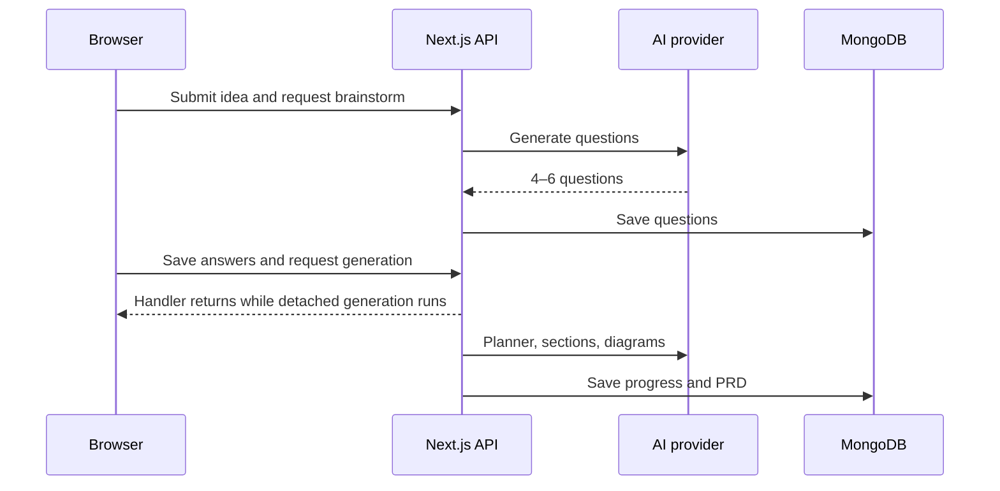
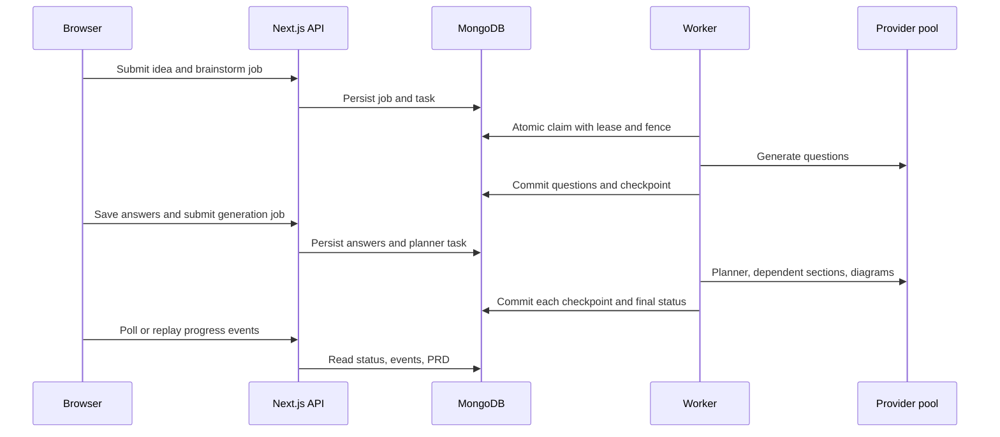

# AI worker deployment

## Execution sequence

Before migration:



After migration:



The web app and worker share one MongoDB Atlas replica set. Run `npm run db:indexes` once before enabling submissions. The worker requires a continuously running Docker host and the variables in `.env.worker.example`; Vercel only serves short API requests.

Before rollout, place `MONGODB_TEST_URI=...` in the ignored root `.env.test.local` and run `node --env-file=.env.test.local ./node_modules/tsx/dist/cli.mjs --test tests/*.test.ts`. The worker Mongo integration test is skipped without that variable. Run `npm run typecheck`, `npm run lint`, `npm run build`, and the Docker build below in CI. Do not point the test URI at production because the test creates its own database and uses concurrency reservations. The test attempts to remove its uniquely named database afterward; if the test account lacks `dropDatabase`, it reports that cleanup was unavailable and closes its connection.

```sh
docker build -f Dockerfile.worker -t ngeprd-worker .
docker run --restart unless-stopped --env-file .env.worker -d --name ngeprd-worker ngeprd-worker
```

Configure providers through the admin-only `/api/admin/providers` endpoint. Add a provider (`kind: "provider"`, HTTPS `baseURL`, model, capabilities, limits), then one or more accounts (`kind: "account"`, providerId, apiKey, quotaGroupId, limits). Put every key sharing an upstream project quota in the same group. The URL host must appear in `AI_PROVIDER_HOST_ALLOWLIST`. `AI_CREDENTIAL_ENCRYPTION_KEY` is a 32-byte hex key; keep it outside MongoDB and never change it without decrypting and re-encrypting stored credentials under a new key.

Check `ai_jobs` for blocked or failed jobs, `ai_tasks` for expired leases and retries, `ai_reservations` for active slots, and `ai_usage` for token records. Expired task leases are claimed again; fenced checkpoint writes prevent old workers from overwriting newer data. A provider account with bad credentials is disabled and needs admin correction. Temporarily limited jobs enter `waiting_capacity` with a scheduled retry.

After fixing provider configuration, an authenticated admin can `POST /api/admin/jobs/{jobId}/retry` to requeue a blocked job. It fails when the owner's active-job limit is full.

For rollout, set `AI_JOB_SUBMISSIONS_ENABLED=false` on the web deployment, create indexes, configure providers, start the worker, then set the flag to `true`. Keep one worker initially; scale only after integration tests on the target Atlas cluster. For rollback, set the flag to `false` first, wait for active jobs or cancel them, then redeploy the previous web version. Do not delete the job collections or existing PRDs during rollback. Old PRD documents remain readable and exportable.

Shutdown: `docker stop ngeprd-worker`; SIGTERM stops new claims and waits for active tasks. Inspect logs with `docker logs ngeprd-worker`. The worker logs IDs and state transitions without prompt text or API keys. Docker checks `/healthz` on the worker loopback interface; `/metrics` returns queue, waiting-capacity, blocked, and local active-task counts. Monitor queue age and task lease expiry in MongoDB.
